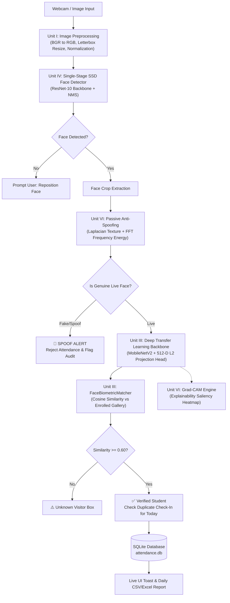

# DeepFaceAttend: Deep Learning Face Scan Attendance System

A comprehensive, academic-grade **Computer Vision & Deep Learning Attendance System** with real-time face scan, passive anti-spoofing liveness detection, metric learning embeddings, and Grad-CAM explainability.

This project is built from first principles and explicitly designed to demonstrate and implement every unit of the **Deep Learning for Computer Vision** curriculum (Units I through VI).

---

## 🎯 Syllabus Alignment Matrix

| Unit | Syllabus Core Topics | Project Implementation & Source File |
| :--- | :--- | :--- |
| **Unit I: Foundations of CV & DL** | Pixels, channels, BGR/RGB/HSV/Grayscale, aspect-ratio letterbox resizing, ImageNet standardization, Perceptron from scratch, MLP | [`modules/unit1_foundations.py`](modules/unit1_foundations.py) |
| **Unit II: CNNs & Training Techniques** | Convolution math, kernels, stride, padding, receptive fields, LeNet $\to$ ResNet $\to$ MobileNet chronology, BatchNorm, Dropout, Augmentations, Kaiming/Xavier init, Early Stopping | [`modules/unit2_cnn_training.py`](modules/unit2_cnn_training.py) |
| **Unit III: Transfer Learning & Fine-Tuning** | Pretrained MobileNetV2 backbone, layer freezing/unfreezing, discriminative layer-wise learning rates, 512-D $L_2$-normalized unit hypersphere embeddings, Cosine similarity | [`modules/unit3_transfer_learning.py`](modules/unit3_transfer_learning.py) |
| **Unit IV: Object Detection & Localization** | Bounding box formats (`xyxy`, `xywh`), IoU from scratch, Non-Maximum Suppression (NMS) from scratch, Single-Stage SSD with ResNet-10 backbone vs Haar Cascades | [`modules/unit4_object_detection.py`](modules/unit4_object_detection.py) |
| **Unit V: Segmentation & Vision Transformers** | Semantic vs Instance segmentation, Lightweight Face UNet with skip connections, Vision Transformer (ViT) with patch embedding & Multi-Head Self-Attention (MHSA) | [`modules/unit5_segmentation_transformers.py`](modules/unit5_segmentation_transformers.py) |
| **Unit VI: Generative Models & Interpretability** | **Grad-CAM (Gradient-weighted Class Activation Mapping)** for visual explainability, Passive Anti-Spoofing Liveness (Laplacian variance + FFT spectrum), VAE / GAN / CLIP | [`modules/unit6_explainability_generative.py`](modules/unit6_explainability_generative.py) |

---

## 🏗️ System Architecture



---

## 🚀 Quickstart Guide

### 1. Prerequisites & Installation

Ensure you have Python 3.10+ installed. Install all dependencies:
```bash
pip install -r requirements.txt
```

### 2. Launch Interactive Streamlit Web Dashboard
Run the flagship web application:
```bash
streamlit run app.py
```
Open your browser at `http://localhost:8501`.

The dashboard includes:
1. **📸 Live Attendance Scanner**: Real-time webcam or image upload, facial bounding box, liveness badge, match percentage, and instant check-in.
2. **👤 Student Registration**: Enroll new students with Roll Number, Name, Department, and photo. Automatically extracts 512-D embeddings into SQLite.
3. **📊 Attendance Logs & Analytics**: Daily attendance logs, KPIs (Total Enrolled, Present, Absent, Attendance Rate %), department breakdown charts, and one-click CSV export.
4. **🔬 Model Explainability (Grad-CAM)**: Inspect deep neural network activation heatmaps on student faces.
5. **🧠 Syllabus & Architecture Hub**: Complete interactive lecture-notes guide with formulas and theory covering Units I to VI for exams/viva.

---

### 3. Launch Standalone Desktop Scanner (OpenCV Mode)
For ultra-fast 30+ FPS desktop webcam scanning without a browser:
```bash
python run_webcam.py
```
- Press `q` to quit
- Press `s` to capture and save a snapshot
- Press `r` to reload the student gallery

---

### 4. Run Comprehensive Unit & Integration Tests
Run the test suite verifying all 6 syllabus units:
```bash
python tests/test_pipeline.py
```

---

## 📁 Repository Directory Structure

```
deep learning of CV/
├── data/
│   ├── attendance.db           # SQLite database (students & attendance logs)
│   ├── registered_faces/       # Cropped enrolled face portraits
│   └── attendance_records/     # Auto-exported daily CSV reports
├── models/
│   ├── deploy.prototxt         # OpenCV SSD detector architecture definition
│   └── res10_300x300_ssd_iter_140000.caffemodel  # SSD detector pre-trained weights
├── modules/
│   ├── __init__.py
│   ├── unit1_foundations.py    # Unit I: Preprocessing, color spaces, Perceptron, MLP
│   ├── unit2_cnn_training.py   # Unit II: CustomFaceCNN, receptive field, augmentations, schedulers
│   ├── unit3_transfer_learning.py # Unit III: MobileNetV2 embedding net, metric learning, cosine similarity
│   ├── unit4_object_detection.py  # Unit IV: BoundingBox, IoU, NMS from scratch, SSD & Haar detectors
│   ├── unit5_segmentation_transformers.py # Unit V: Lightweight Face UNet, Face Vision Transformer (ViT)
│   └── unit6_explainability_generative.py # Unit VI: Grad-CAM, Anti-Spoofing Liveness, VAE/GAN/CLIP
├── core/
│   ├── __init__.py
│   ├── database.py             # SQLite relational schema, CRUD, deduplication, CSV export
│   └── attendance_engine.py    # Master pipeline orchestrating detection, liveness, recognition & HUD
├── scripts/
│   └── seed_demo_data.py       # Seeds demo students for instant out-of-the-box testing
├── tests/
│   └── test_pipeline.py        # Automated test suite (Units I-VI + DB)
├── app.py                      # Interactive Streamlit Web Application
├── run_webcam.py               # Standalone high-FPS OpenCV Webcam Scanner
├── requirements.txt            # Project dependencies
├── README.md                   # System documentation & quickstart
└── PROJECT_REPORT.md           # Exhaustive academic report for viva and submission
```

---

## 🛡️ Anti-Spoofing & Biometric Security
The system protects against presentation attacks using a dual-modality passive check:
1. **Laplacian Variance Focus Analysis**: Real 3D human faces have micro-textures and natural depth gradients. Re-photographed 2D flat paper prints exhibit blur and flat Laplacian distributions.
2. **Fast Fourier Transform (FFT) High-Frequency Analysis**: Digital screens (smartphones/monitors) emit distinct periodic high-frequency spatial patterns (Moiré effects) which are detected and flagged.

---

## 🔬 Model Interpretability with Grad-CAM
Grad-CAM highlights the discriminative facial features used by the deep neural network:
$$\alpha_k^c = \frac{1}{Z} \sum_{i} \sum_{j} \frac{\partial y^c}{\partial A_{ij}^k}, \quad L_{\text{Grad-CAM}}^c = \text{ReLU}\left( \sum_k \alpha_k^c A^k \right)$$
Grad-CAM guarantees that the attendance system bases its verification on salient anatomical facial landmarks (eyes, bridge of nose, jawline) rather than spurious background artifacts.
